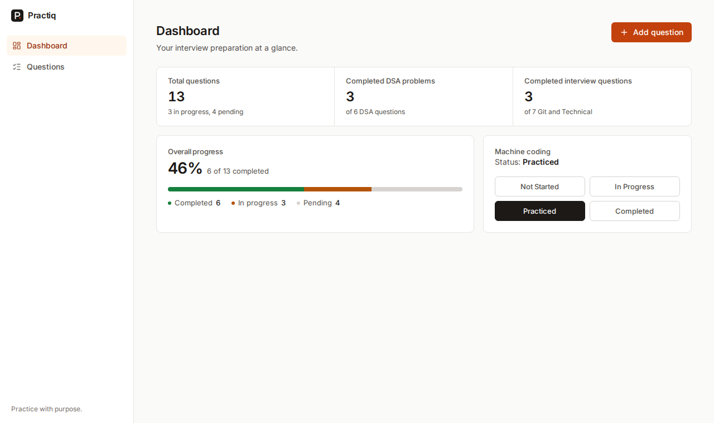
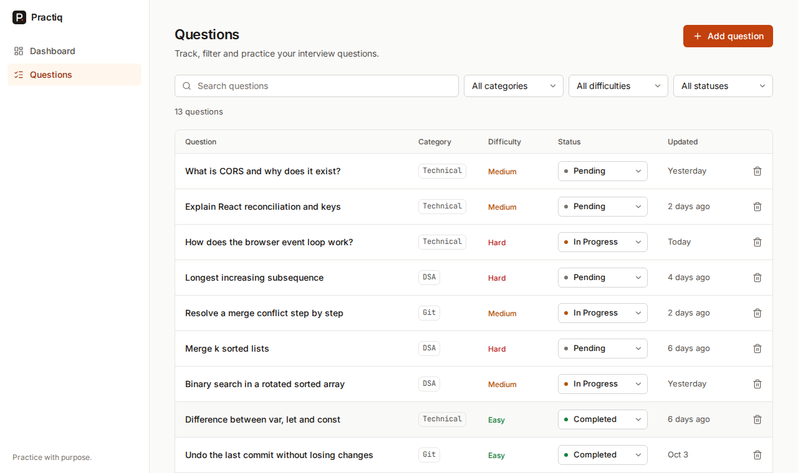
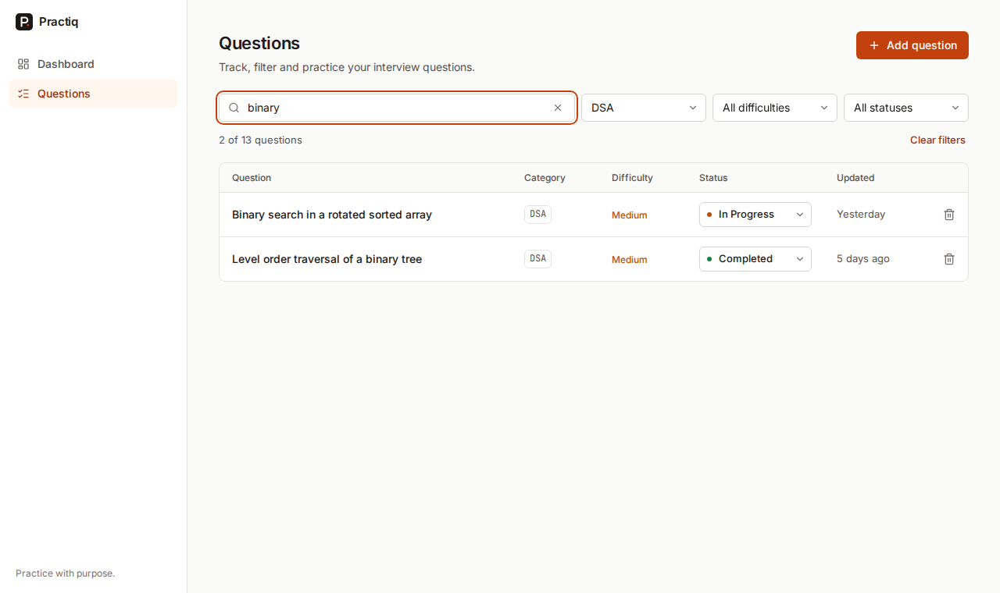
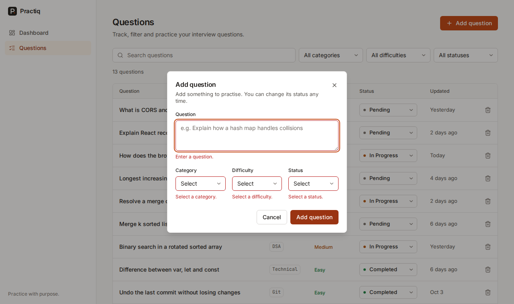
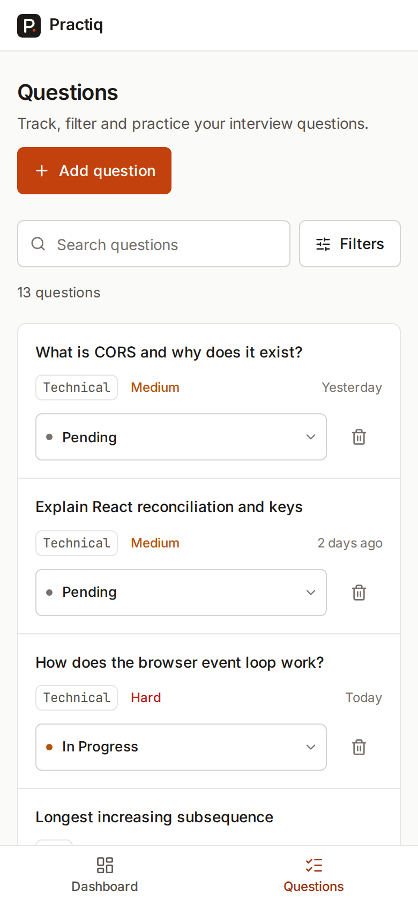
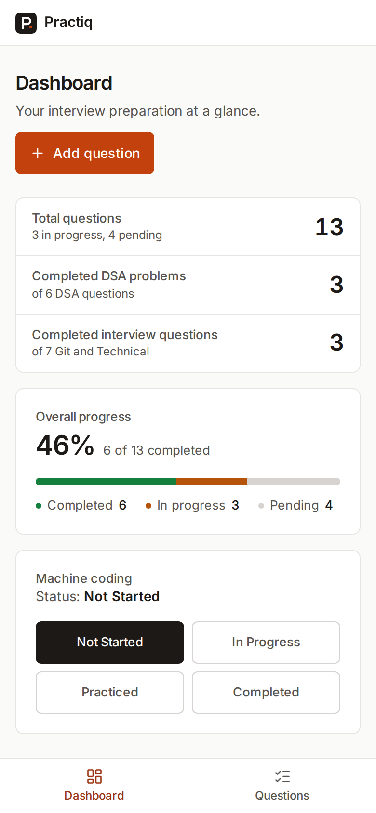

# Practiq

**Practice with purpose.** Practiq is a responsive interview-practice tracker for students preparing for technical interviews. Track the questions you're working through, see where you stand at a glance, and keep your machine-coding preparation honest. Everything is saved in your browser, so it's all still there after a refresh.



## Features

- **Question tracker.** Add questions with a category (DSA, Git, Technical), difficulty (Easy, Medium, Hard) and status (Pending, In Progress, Completed). Change a status inline from the list, or delete with a confirmation.
- **Search and filters.** Case-insensitive text search plus category, difficulty and status filters. They all combine, so *DSA + Medium + In Progress + "binary"* returns exactly the matching questions. A live result count and a one-click "Clear filters" are included.
- **Dashboard.** Total questions, completed DSA problems, completed interview questions and machine-coding status. Every number is derived from your stored data; nothing is hardcoded.
- **Progress.** Completion percentage and a segmented completed / in-progress / pending bar, updated the moment a status changes.
- **Machine-coding status.** A single four-step status (Not Started, In Progress, Practiced, Completed) you can update from the dashboard.
- **Persistence.** Data is saved to `localStorage` through a repository abstraction, survives reloads and navigation, and recovers safely from corrupt or outdated data.
- **Designed states.** Loading skeletons, an empty tracker with a clear first action, a dedicated no-results state, and form validation with specific messages.
- **Responsive.** Sidebar and full table on desktop; bottom tab bar, stacked sections, question cards and collapsible filters on mobile. Verified at 320, 375, 768, 1024 and 1440px with no horizontal page scroll.
- **Accessible.** Keyboard-operable end to end, visible focus, labelled forms, native dialogs and controls, screen-reader announcements for changes, `prefers-reduced-motion` respected. axe-core reports zero violations across every page and state tested.

| Questions | Filtering | Validation |
|---|---|---|
|  |  |  |

<p>
  
  
</p>

## Tech stack

| | |
|---|---|
| UI | React 19, TypeScript (strict, no `any`) |
| Build | Vite |
| Styling | Tailwind CSS v4 with design tokens in CSS (`@theme`) |
| Routing | React Router |
| Icons | Lucide |
| Fonts | Inter and JetBrains Mono, self-hosted via Fontsource |
| Tests | Vitest |
| Lint | oxlint |

There is no state-management library: React Context + `useReducer` is enough for this app. Dependencies were added only when a feature needed them.

## Setup

Requires Node 20 or newer.

```bash
npm install
npm run dev        # http://localhost:5173
```

## Development

| Command | What it does |
|---|---|
| `npm run dev` | Start the dev server |
| `npm run build` | Type-check, then build for production into `dist/` |
| `npm run preview` | Serve the production build locally |
| `npm run lint` | Lint with oxlint |
| `npm test` | Run unit tests once |
| `npm run test:watch` | Run tests in watch mode |
| `npm run check` | Lint, test and build (what to run before pushing) |

## Architecture

```
UI components  ->  usePractice() hook  ->  PracticeProvider (reducer)  ->  PracticeRepository  ->  localStorage
```

- **Components** only render and call actions from `usePractice()`. They never touch storage.
- **`practiceReducer`** is a pure function. Ids and timestamps are created by the caller and passed in the action, so it is deterministic and easy to test.
- **Derived data is never stored.** Dashboard stats come from `selectStats(questions)` and filtered lists from `filterQuestions(questions, filters)`, both pure functions.
- **Filters are UI state.** They live in the Questions page with `useState`, not in global state.
- **Persistence sits behind an interface** (`PracticeRepository`: `load()` and `save()`). `localStorageRepository.ts` is the only file that references `localStorage`. See [docs/ARCHITECTURE.md](docs/ARCHITECTURE.md) for the full reasoning.

### Folder structure

```
src/
  app/            App shell, router, providers, nav items
  components/
    ui/           Button, Input, Select, Textarea, Modal, Badge, Skeleton, FormField, SearchInput
    layout/       Sidebar, BottomNav, MobileHeader, PageHeader, Logo
    common/       EmptyState, ConfirmDialog, StorageWarning, LiveRegion
    dashboard/    StatsRow, ProgressSummary
    questions/    QuestionList, QuestionRow, QuestionCard, QuestionForm, QuestionToolbar, ...
  features/
    practice/     Reducer, context, provider, usePractice (app state)
    questions/    Filtering, validation, question factory
    progress/     selectStats (dashboard and progress calculations)
    machine-coding/  MachineCodingCard
  pages/          DashboardPage, QuestionsPage, NotFoundPage
  services/       Repository interface, localStorage adapter, storage parsing/migration
  constants/      Category/difficulty/status lists, sample data
  types/          Question types and runtime type guards
  hooks/  utils/
```

## Data model

```ts
const CATEGORIES = ['DSA', 'Git', 'Technical'] as const
const DIFFICULTIES = ['Easy', 'Medium', 'Hard'] as const
const STATUSES = ['Pending', 'In Progress', 'Completed'] as const
const MACHINE_CODING_STATUSES = ['Not Started', 'In Progress', 'Practiced', 'Completed'] as const

interface Question {
  id: string
  question: string
  category: Category      // derived from the arrays above
  difficulty: Difficulty
  status: Status
  createdAt: string       // ISO 8601
  updatedAt: string
}
```

The option lists are `as const` arrays and the types are derived from them, so the dropdowns, validation and storage checks always agree.

## LocalStorage strategy

Everything is stored as one JSON document under the key `practiq:v1`:

```json
{ "version": 1, "questions": [ ... ], "machineCoding": "Practiced" }
```

- **First visit / missing data:** starts with an empty tracker and defaults.
- **Malformed JSON or wrong shape:** falls back to defaults without crashing, and keeps the unreadable payload under `practiq:v1:corrupt` so it can be recovered by hand.
- **Partially bad data:** individual invalid or duplicate-id questions are dropped; the rest survive.
- **Migration:** a `migrate()` step upgrades older shapes (the original bare-array format is handled). Unknown future versions are not guessed at; they fall back to defaults.
- **Write failures** (storage full or blocked): the app keeps working in memory and shows a non-blocking warning.
- **Swapping the backend:** implement `PracticeRepository` against an API and change one line in `src/services/index.ts`. No component or reducer changes.

## Design

Typography does most of the work: Inter for UI, JetBrains Mono for small metadata. Colour is restrained: warm neutrals, one orange accent reserved for primary actions and the active nav item, and green/amber/red used only for status and difficulty. Surfaces use 1px borders instead of shadows, and the question list is a table rather than a stack of cards. The accent is `#C2410C` rather than a brighter orange because white text on it needs to meet WCAG AA contrast (5.2:1).

## Assumptions

The brief leaves a few things open. These are the choices made:

- **"Completed interview questions"** counts completed questions in the **Git** and **Technical** categories. **"Completed DSA problems"** counts completed **DSA** questions.
- **Machine-coding status** is one global status for the student, not per question, with four steps: Not Started, In Progress, Practiced, Completed.
- **"Weekly" tracking** is supported through `createdAt` / `updatedAt` timestamps; there is no weekly planner view, since it isn't in the requirements.
- A first-time user sees an **empty tracker**, with an optional **Load sample questions** button to try the app with demo data.
- Duplicate questions (ignoring case and extra spaces) are rejected by the form.
- Single-user, single-browser: data lives in this browser's `localStorage`, so clearing site data clears the tracker.

## Testing

`npm test` runs 40 unit tests covering the logic most likely to break: search and combined filtering, dashboard and progress calculations, form validation, the reducer, and storage parsing (corrupt data, migration, missing fields, unavailable storage).

UI behaviour was also checked in a real browser: add / status change / delete, combined filters, persistence across reloads, empty and no-results states, keyboard-only use, layout at five viewport widths, and an automated axe-core accessibility audit of each page and state.

## Git workflow

Built incrementally with [Conventional Commits](https://www.conventionalcommits.org/): `feat`, `fix`, `style`, `a11y`, `test`, `docs`, `chore`. Each commit is one meaningful change, and bugs found while testing were fixed in their own `fix:` commits rather than folded into feature work.

## Future improvements

Authentication, a backend API and cloud sync (the repository interface is the seam for this), interview notes per question, coding-platform integration, analytics, and reminders. Dark mode is straightforward because colours are tokens. These are deliberately not implemented.

## Deployment

It's a static single-page app (`npm run build` outputs `dist/`). `vercel.json` includes the rewrite needed so that refreshing on `/questions` doesn't 404. On Vercel or Netlify, use the Vite preset with build command `npm run build` and output directory `dist`.
